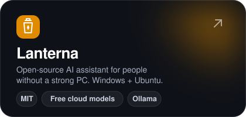
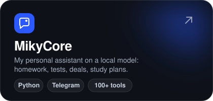
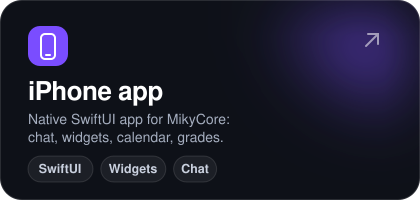
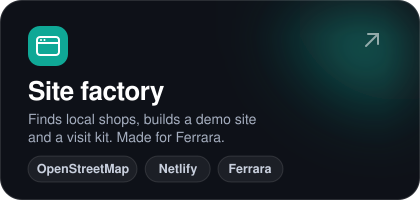
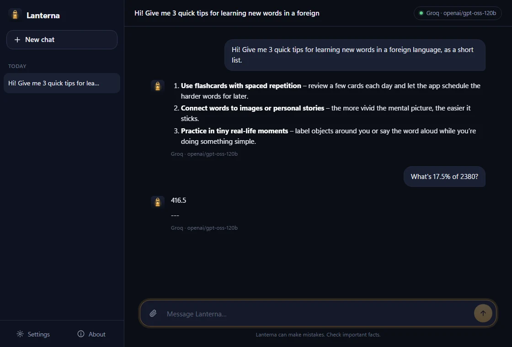
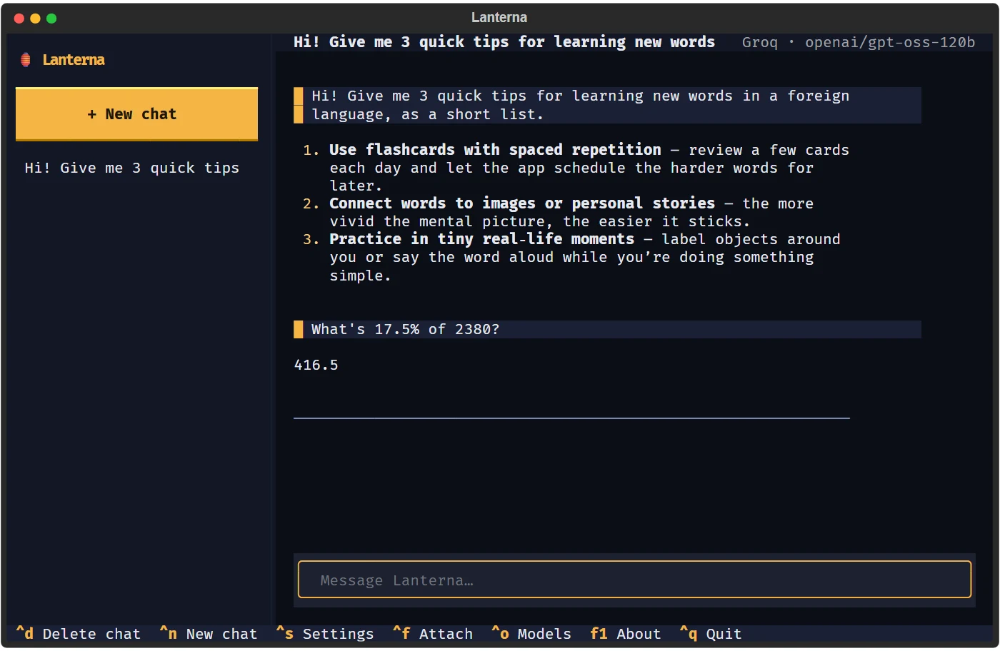
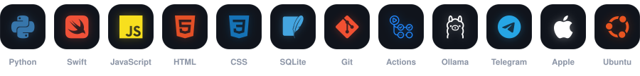

 

   

I'm a computer science student in Ferrara. I like building things that work on their own: an assistant that runs on my PC and keeps track of school, bots that do the boring parts, and small sites for shops around me. Everything below is something I actually shipped.

 

### What I'm building

<table>
<tr>
<td width="50%"></td>
<td width="50%"></td>
</tr>
<tr>
<td width="50%"></td>
<td width="50%"></td>
</tr>
</table>

  

  

 

Lanterna: a window app on Windows and a terminal app on Ubuntu.

  

### What I use

 

### Right now

- **Lanterna**: keeping it fast and easy to install, adding features people ask for.
- **MikyCore**: teaching it to handle more of my school week by itself.
- **Learning**: fine-tuning a small model on my own conversations.

 

I speak 🇺🇦 Ukrainian · 🇮🇹 Italian · 🇬🇧 English. The fastest way to reach me is Telegram.

 

